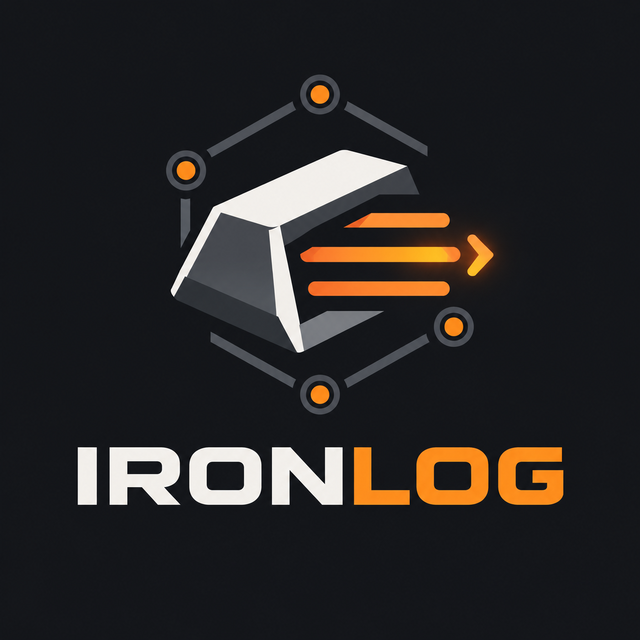
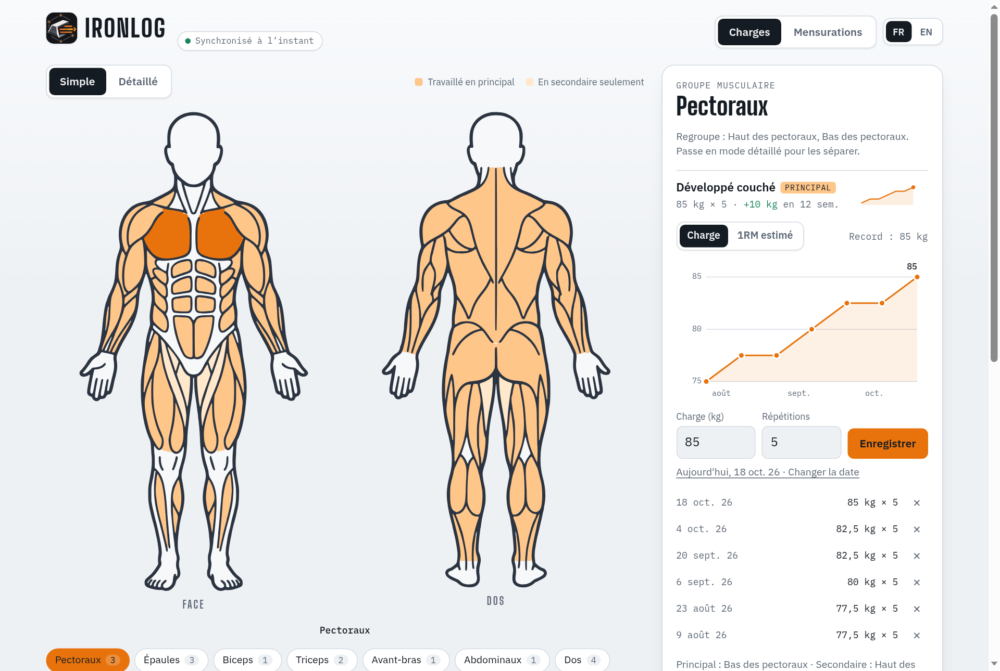
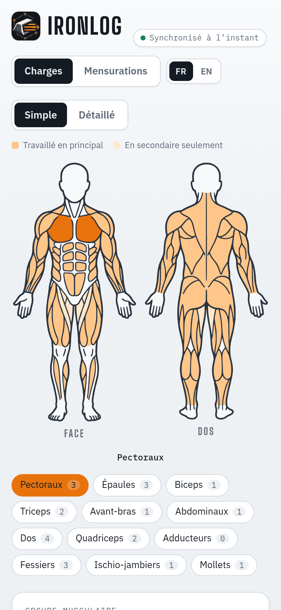
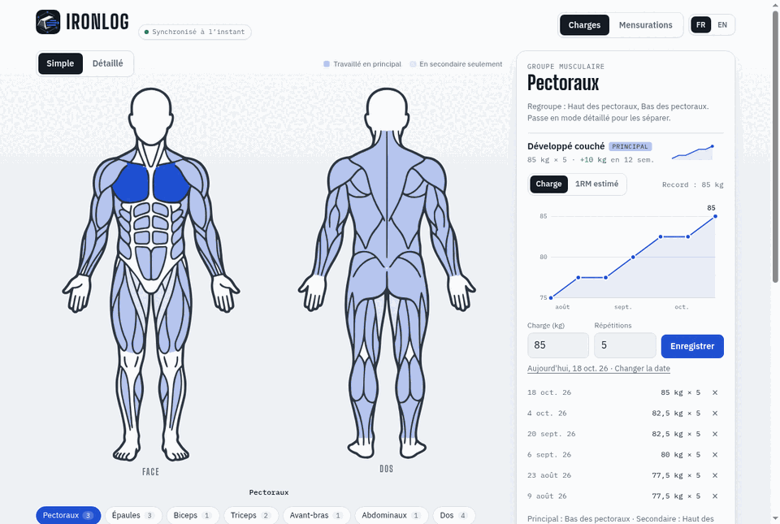
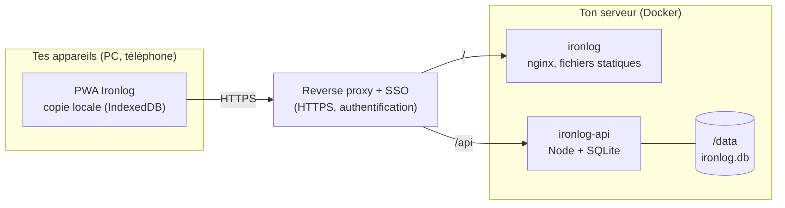

<p align="center">
  
</p>

# Ironlog

[](https://github.com/XNinety9/Ironlog/actions/workflows/ci.yml)
[](https://github.com/XNinety9/Ironlog/releases)
[](https://github.com/XNinety9/Ironlog/pkgs/container/ironlog)


[English](README.md) · **Français**

Suis tes charges et tes mensurations sur un schéma du corps cliquable. Installable sur ton téléphone, utilisable hors ligne à la salle, et partagée entre tous tes appareils grâce à ton propre serveur.

<p align="center">
  
  &nbsp;
  
</p>

<p align="center">
  
  <br>
  <sub>Visite : charges et leur graphe → vue d'ensemble des mensurations → historique d'une mesure.</sub>
</p>

## Fonctionnalités

**Charges**
- Schéma du corps de face et de dos, en mode *simple* (groupes musculaires) ou *détaillé* (muscles individuels).
- Chaque exercice est rattaché à un ou plusieurs muscles, en **principal** ou en **secondaire**. Un développé couché peut compter pour les pectoraux en principal et les triceps en secondaire.
- Saisie de la charge et des répétitions pour chaque séance, datée du jour ou d'une date passée.
- Graphe de progression en charge ou en **1RM estimé** (formule d'Epley), avec ton record. Graphe et historique sont par exercice.

**Mensurations**
- Place des points librement sur le corps (un toucher sur la figure), nomme-les, et note leurs valeurs dans le temps.
- Glisse les points et les étiquettes pour réorganiser la mise en page ; les étiquettes ne bougent qu'à la verticale.
- Graphe et historique par mesure.

**Données et appareils**
- Tes données sont sur **ton serveur** (SQLite dans un volume Docker). Chaque appareil qui ouvre la même instance voit les mêmes données.
- Chaque appareil garde une copie locale : l'app marche hors ligne. Les modifications partent dès que le réseau revient.
- Export et import d'une sauvegarde JSON à tout moment.

**Partout**
- Installable comme application (PWA) sur téléphone et ordinateur.
- Interface en **français** et en **anglais**, à changer dans l'en-tête. Elle suit la langue du navigateur par défaut.
- Thème clair et sombre, selon le réglage de ton système.

## Architecture



L'API ne reçoit jamais de trafic non authentifié : elle fait confiance à l'en-tête `X-Auth-Request-User` posé par ton reverse proxy. Ne l'expose que derrière ce proxy.

## Démarrage rapide

### Avec Docker (recommandé)

```sh
mkdir -p .data
docker compose up --build        # puis ouvre http://localhost:8080
```

En local il n'y a pas de SSO : toutes les données sont attribuées à l'utilisateur `IRONLOG_DEV_USER` (voir `docker-compose.yml`).

### Images

Publiées à chaque release sur GitHub Container Registry :

| Image | Rôle | Base |
| --- | --- | --- |
| `ghcr.io/xninety9/ironlog` | Application web (fichiers statiques, nginx) | `cgr.dev/chainguard/nginx`, ~29 Mo |
| `ghcr.io/xninety9/ironlog-api` | API de synchronisation, base SQLite dans `/data` | `cgr.dev/chainguard/node` |

Les deux tournent en utilisateur non-root, sans shell, et exposent un healthcheck. Les images sont scannées par Trivy dans la CI.

### Déploiement derrière un reverse proxy

L'application doit être servie en HTTPS (service worker, installation de la PWA). Route `/api/*` vers `ironlog-api:3000` et le reste vers `ironlog:8080`, derrière ton authentification. Monte un volume sur `/data` pour que l'API garde sa base.

## Développement

Prérequis : Node 24 ou plus (l'API utilise `node:sqlite`, intégré à Node).

```sh
npm install          # installe les workspaces front et back
npm run dev:api      # API sur :3000, base dans .data/
npm run dev          # app sur :5173 (redirige /api vers l'API)
npm run check        # vérification des types du front (svelte-check + tsc)
npm test             # tests de l'API (node:test, aucune dépendance)
npm run build        # build de production dans frontend/dist
```

### Organisation du dépôt

```
frontend/   PWA Svelte 5 : src/, public/, service worker (sw/), Dockerfile, nginx et sonde (docker/)
backend/    API de synchronisation (Node, SQLite) : app, validation, base, tests, Dockerfile
outils/     Script qui vectorise le schéma du corps à partir d'une illustration de référence
maquette/   Première maquette HTML statique, gardée comme référence
```

La racine est un workspace npm. Son `package.json` porte **la** version de l'app, partagée par le front, le back et le tag de release.

### Traductions

Les textes sont dans `frontend/src/lib/i18n/` : `fr.ts` est le dictionnaire de référence, et `en.ts` doit contenir exactement les mêmes clés (le compilateur le vérifie). Ajoute une clé dans les deux fichiers, puis utilise `t('ta.cle')` dans un composant.

## Releases

La CI tourne à chaque push et pull request : vérification des types, tests de l'API, build, scan Trivy des deux images, puis publication sur GHCR (branche `develop` → tag `develop`, `main` → `main` et `latest`).

Pour publier une version :

```sh
# sur main, après la fusion de develop
npm version X.Y.Z --no-git-tag-version       # met à jour le package.json racine
# ajoute une section "## [X.Y.Z]" dans CHANGELOG.md (anglais, puis français)
git commit -am "Version X.Y.Z" && git push
git tag -a vX.Y.Z -m "Ironlog X.Y.Z" && git push origin vX.Y.Z
```

Le workflow du tag vérifie que le tag correspond à `package.json`, produit l'archive statique avec ses empreintes SHA-256, publie les images, et crée la release GitHub avec la section du changelog comme notes.

## Vie privée

Tes données ne quittent jamais ton serveur. Pas de service tiers, pas d'analytique, aucune requête externe depuis l'app.

## Licence

Aucune licence n'a encore été choisie. Le schéma du corps a été vectorisé à partir d'une illustration tierce dont la licence n'est pas confirmée. Tant qu'une licence n'est pas ajoutée, tous les droits sont réservés et le code n'est pas distribué sous licence pour réutilisation.
