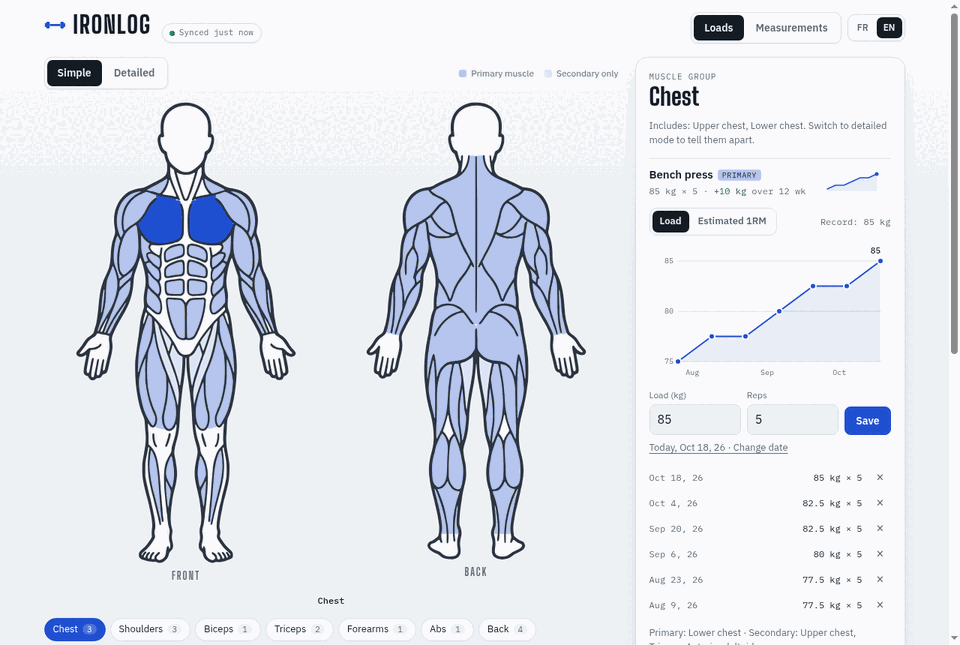
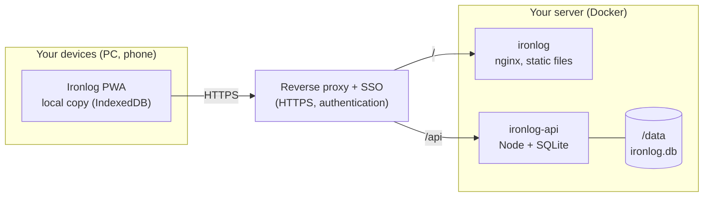

<p align="center">
  
</p>

# Ironlog

[](https://github.com/XNinety9/Ironlog/actions/workflows/ci.yml)
[](https://github.com/XNinety9/Ironlog/releases)
[](https://github.com/XNinety9/Ironlog/pkgs/container/ironlog)


**English** · [Français](README.fr.md)

Track your lifts and body measurements on a clickable body map. Installable on your phone, usable offline at the gym, and shared between all your devices through your own server.

<p align="center">
  
  <br>
  <sub>Tour: loads and their progress chart → measurements overview → history of one measurement.</sub>
</p>

## Features

**Loads**
- Front and back body map, in *simple* mode (muscle groups) or *detailed* mode (individual muscles).
- Each exercise is linked to one or more muscles, as **primary** or **secondary**. A bench press can count for the chest as primary and the triceps as secondary.
- Log the load and reps for each session, dated today or on a past date.
- Progress chart in load or **estimated 1RM** (Epley formula), with your record. Chart and history are per exercise.

**Measurements**
- Place points freely on the body (tap the figure), name them, and log their values over time.
- Drag points and labels to reorganise the layout; labels only move vertically, so nothing goes astray.
- Chart and history per measurement.

**Data and devices**
- Your data lives on **your server** (SQLite in a Docker volume). Every device that opens the same instance sees the same data.
- Each device keeps a local copy, so the app works offline. Changes are sent as soon as the network is back.
- Export and import a JSON backup at any time.

**Everywhere**
- Installable as a PWA on phone and desktop.
- Interface in **English** and **French**, switchable in the header. It follows your browser language by default.
- Light and dark theme, following your system setting.

## Architecture



The API never receives unauthenticated traffic: it trusts the `X-Auth-Request-User` header set by your reverse proxy. Expose it only through that proxy.

## Quick start

### With Docker (recommended)

```sh
mkdir -p .data
docker compose up --build        # then open http://localhost:8080
```

Locally there is no SSO, so all data is attributed to the `IRONLOG_DEV_USER` user (see `docker-compose.yml`).

### Images

Published on every release to GitHub Container Registry:

| Image | Role | Base |
| --- | --- | --- |
| `ghcr.io/xninety9/ironlog` | Web app (static files, nginx) | `cgr.dev/chainguard/nginx`, ~29 MB |
| `ghcr.io/xninety9/ironlog-api` | Sync API, SQLite database in `/data` | `cgr.dev/chainguard/node` |

Both run as non-root, without a shell, and expose a healthcheck. The images are scanned with Trivy in CI.

### Deployment behind a reverse proxy

The web app must be served over HTTPS (service worker, PWA installation). Route `/api/*` to `ironlog-api:3000` and everything else to `ironlog:8080`, behind your authentication. Mount a volume on `/data` for the API to keep the database.

## Development

Requirements: Node 24 or later (the API uses the built-in `node:sqlite`).

```sh
npm install          # installs the frontend and backend workspaces
npm run dev:api      # API on :3000, database in .data/
npm run dev          # app on :5173 (proxies /api to the API)
npm run check        # type-check the frontend (svelte-check + tsc)
npm test             # API tests (node:test, no dependencies)
npm run build        # production build in frontend/dist
```

### Project layout

```
frontend/   Svelte 5 PWA: src/, public/, service worker (sw/), Dockerfile, nginx config and probe (docker/)
backend/    Sync API (Node, SQLite): app, validation, database, tests, Dockerfile
outils/     Script that vectorises the body map from a reference illustration
maquette/   First static HTML mock-up, kept as a reference
```

The root is an npm workspace. Its `package.json` holds **the** app version, shared by the frontend, the backend and the release tag.

### Translations

Texts live in `frontend/src/lib/i18n/`: `fr.ts` is the reference dictionary, and `en.ts` must contain exactly the same keys (the compiler checks it). Add a key in both files, then use `t('your.key')` in a component.

## Releases

CI runs on every push and pull request: type-check, API tests, build, Trivy scan of both images, and publication to GHCR (branch `develop` → tag `develop`, `main` → `main` and `latest`).

To publish a version:

```sh
# on main, after merging develop
npm version X.Y.Z --no-git-tag-version       # updates the root package.json
# add a "## [X.Y.Z]" section to CHANGELOG.md (English, then French)
git commit -am "Version X.Y.Z" && git push
git tag -a vX.Y.Z -m "Ironlog X.Y.Z" && git push origin vX.Y.Z
```

The tag workflow checks that the tag matches `package.json`, builds the static archive with SHA-256 checksums, publishes the images, and creates the GitHub release with the changelog section as notes.

## Privacy

Your data never leaves your server. There are no third-party services, no analytics, and no external requests from the app.

## Licence

No licence has been chosen yet. The body map was vectorised from a third-party illustration whose licence is not confirmed. Until a licence is added, all rights are reserved and the code is not licensed for reuse.
